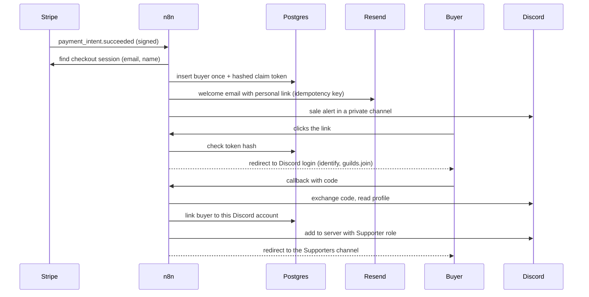

# Buyer onboarding with n8n

When someone buys my **Guide AI MVP**, they automatically get a **Supporter** role on my Discord, a buyers-only space to ask questions and share their project. If they get a refund or open a dispute, the role goes away.

This runs in production on a self-hosted n8n (`n8n.laforet.dev`, Docker on a VPS managed by Dokploy).

## How it works

| Workflow | Trigger | Job |
| --- | --- | --- |
| `00-setup-buyers-table` | Manual | Creates the `buyers` table (run once) |
| `01-stripe-events` | Stripe webhook | New purchase: save buyer, send email, alert. Refund or dispute: revoke the role |
| `02-discord-claim` | 2 webhooks | Claim link and Discord OAuth2 callback; grants the role |
| `03-claim-reminder` | Daily at 10:00 | One reminder 48h after purchase, with a fresh link |
| `04-error-alerts` | Error Trigger | Posts any failed run to a private Discord channel |

## Design choices

- **Stripe retries are harmless.** A unique key on the payment intent means a repeated event inserts nothing, so no second email goes out.
- **No duplicate emails.** Every Resend call carries an `Idempotency-Key` (`welcome/<payment intent>`, `reminder/<payment intent>`).
- **Claim tokens are never stored.** Postgres keeps only their SHA-256. The plain token exists only in the buyer's email.
- **One purchase, one Discord account.** The callback links the buyer row to the first Discord account that uses the link. The same account can retry safely; another account is refused.
- **Works for people who never joined the server.** The `guilds.join` scope lets the bot add the buyer with the role in one call. The role is granted again in a second call in case they were already a member.
- **Reminders go out at most once.** A single SQL statement picks due buyers, rotates their token and marks the reminder, with `FOR UPDATE SKIP LOCKED` so overlapping runs can't double-send.
- **Refunds only revoke on a full refund.** Partial refunds are ignored; disputes always revoke. A buyer who already left the server counts as done.
- **Failures are visible.** If Discord refuses a grant, the buyer sees a friendly page and the run fails on purpose, so the error workflow alerts me with a link to the execution.
- **No secrets in the workflows.** Keys live in n8n credentials; IDs and URLs live in a **Config** node at the start of each workflow.

## Setup

### 1. Run n8n

`infra/docker-compose.yml` runs n8n 2.44.6, Postgres 17 and the external task runner. On first boot, Postgres also creates a separate `onboarding` database and role for buyer data.

Environment variables: `POSTGRES_USER`, `POSTGRES_PASSWORD`, `POSTGRES_DB`, `N8N_ENCRYPTION_KEY`, `N8N_HOST`, `ONBOARDING_DB_PASSWORD`, `N8N_RUNNERS_AUTH_TOKEN`, optional `GENERIC_TIMEZONE`. Generate secrets with `openssl rand -hex 32`.

### 2. Discord

1. Create an application at <https://discord.com/developers/applications>.
2. **OAuth2**: add the redirect `https://<your n8n host>/webhook/supporter/callback`. Note the client ID and secret.
3. **Bot**: copy the token. Invite it with Create Invite + Manage Roles:
   `https://discord.com/oauth2/authorize?client_id=<CLIENT_ID>&scope=bot&permissions=268435457`
4. In **Server Settings > Roles**, drag the bot's role above the Supporter role.

### 3. n8n credentials

| Credential | Type | Value |
| --- | --- | --- |
| Postgres onboarding | Postgres | host `postgres`, database and user `onboarding` |
| Stripe | Stripe API | restricted key: Webhook Endpoints write, Checkout Sessions read, Charges read |
| Resend | Header Auth | name `Authorization`, value `Bearer re_...` |
| Discord bot | Discord Bot API | bot token |
| Discord OAuth client | Basic Auth | user = client ID, password = client secret |

### 4. Import and publish

1. Import the five files from `workflows/`, select the credentials on each node, and fill in each **Config** node.
2. Execute **Setup: create the buyers table** once.
3. Publish **Error alerts**, then set it as the error workflow in the settings of the other three.
4. Publish the other three. Publishing the Stripe workflow registers its webhook endpoint in Stripe automatically.

The Stripe workflow expects `metadata.productSlug` on the PaymentIntent, which my checkout sets. Change `productSlug` in **Config** for another product.
